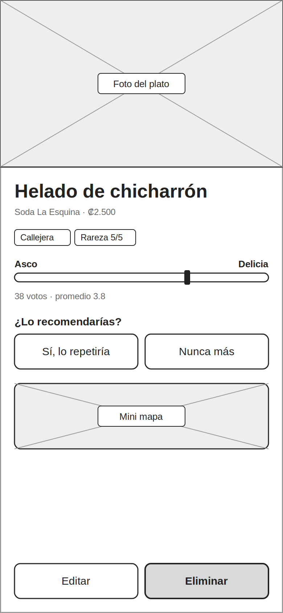
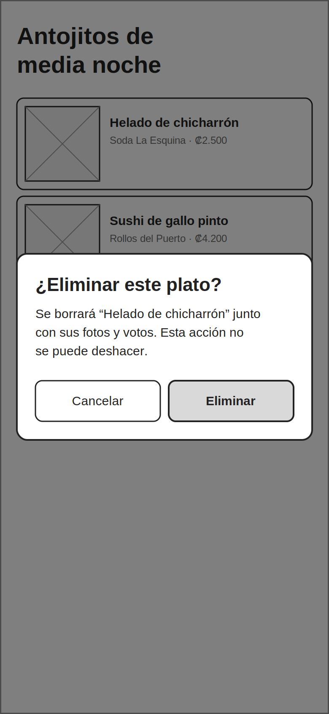
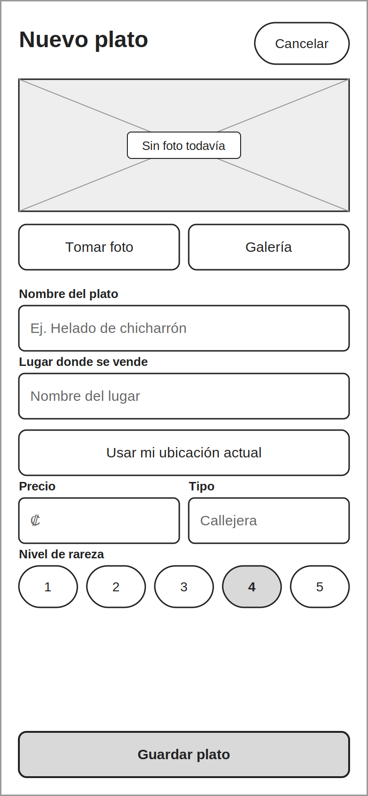
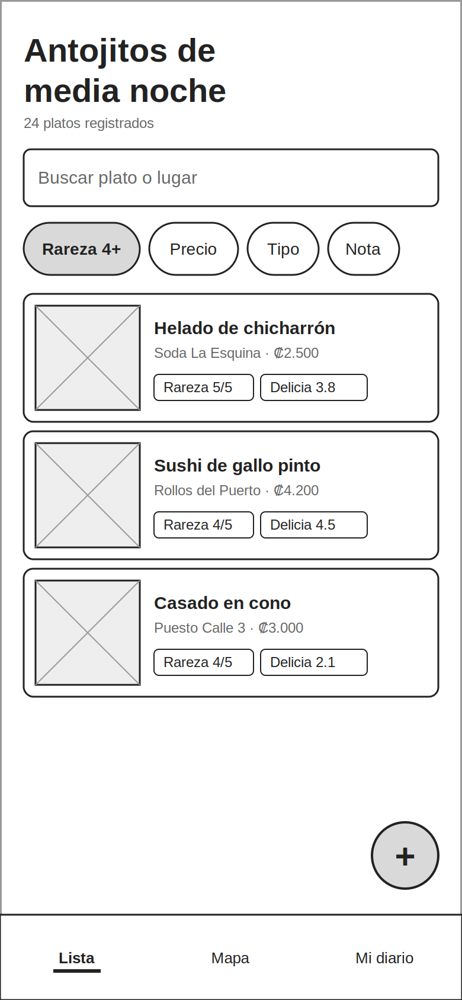
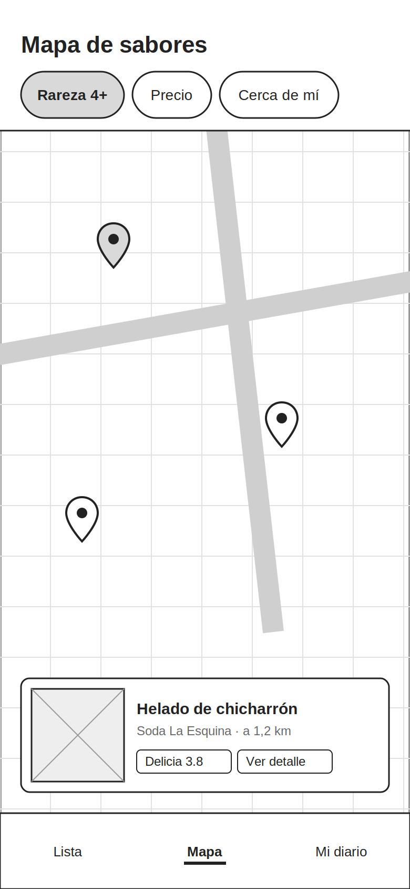

# Antojitos de media noche

## Descripción de la idea
Antojitos de media noche es una app móvil para registrar, calificar y
descubrir comidas raras y combinaciones atrevidas que se venden en
sodas, ferias y puestos callejeros (por ejemplo, helado de chicharrón o
sushi de gallo pinto). Cada usuario guarda el plato con foto, precio,
lugar y nivel de rareza, y la comunidad lo califica en una escala de
"asco" a "delicia". La app permite filtrar por rareza, precio, tipo y
calificación, y ubicar en un mapa dónde conseguir cada plato.

## Integrantes
- Derian Oreamuno Fernández
- Cristopher Rosales Zamora

- 
- 
- 
- 
- 
